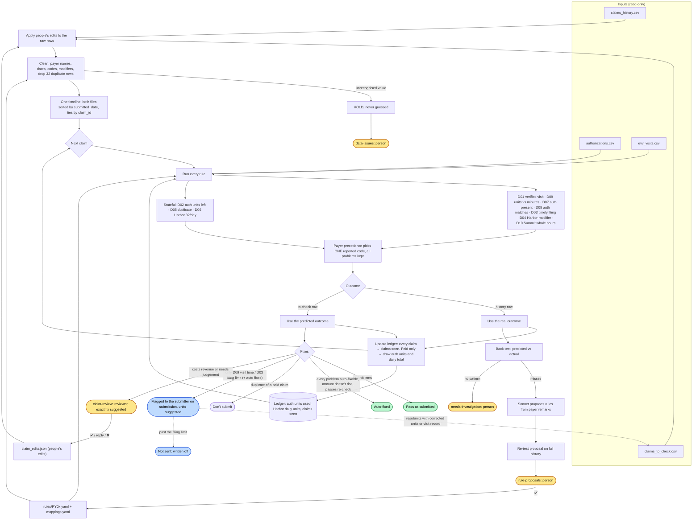
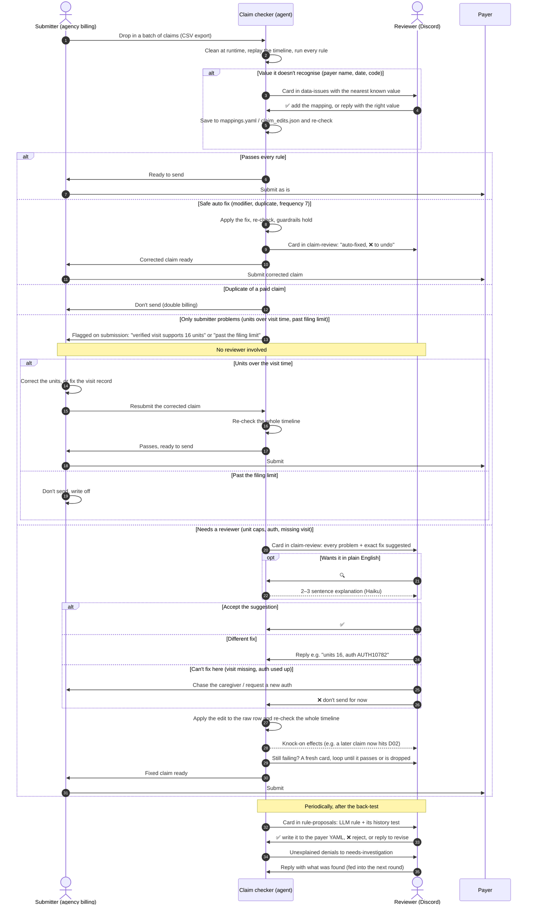

# Pre-submission claim checker

Checks home-care claims **before they go to the payer**. For each claim it predicts paid or denied (and the denial
code), applies the safe fixes on its own, sends problems the submitter can fix (visit time, filing limit) straight
back to them, and sends only the judgement calls to a reviewer through a Discord bot (standing in for Slack).

> **Rules decide. People approve anything that costs money or is ambiguous. The LLM explains, and proposes new rules.**

---

## Results

**Back-test on 3,830 past claims** (history and to-check claims replayed as one timeline):

| Metric | Result |
|---|---|
| Exact match (status and denial code) | **98.1%** (3,756 / 3,830) |
| Excluding the 61 generic D99 "contact payer" denials | **99.7%** |
| Every rule-based code, D01–D10 | **100%** caught |
| Paid claims wrongly predicted denied | 1 / 2,731 |

**The 546 claims to check** (`output/predictions.csv`):

| Outcome | Claims | |
|---|---:|---|
| Pass as submitted | 377 | |
| Auto-fixed, then re-checked | 4 | $320.80 recovered |
| Don't submit (duplicate of a paid claim) | 27 | |
| Back to the submitter (units over the visit time, past the filing limit) | 46 | $4,201.20, shown when submitting |
| Needs a reviewer (with the exact fix suggested) | 92 | $10,506.20 at risk |

**A reviewer sees 92 of 546 claims (16.8%)** instead of all of them. Another 46 (8.4%) go straight back to the
submitter, and the other 408 (74.7%) need no one.

### Confusion matrix (back-test)

Rows are what the payer actually did, columns are what we predicted. `·` = 0.

| actual ↓ / predicted → | PAID | D01 | D02 | D03 | D04 | D05 | D06 | D07 | D08 | D09 | D10 |
|---|---:|---:|---:|---:|---:|---:|---:|---:|---:|---:|---:|
| **PAID** | **2730** | · | 1 | · | · | · | · | · | · | · | · |
| **D01** | · | **181** | · | · | · | · | · | · | · | · | · |
| **D02** | · | · | **65** | · | · | · | · | · | · | · | · |
| **D03** | · | · | · | **218** | · | · | · | · | · | · | · |
| **D04** | · | · | · | · | **37** | · | · | · | · | · | · |
| **D05** | · | · | · | · | · | **27** | · | · | · | · | · |
| **D06** | · | · | · | · | · | · | **79** | · | · | · | · |
| **D07** | · | · | · | · | · | · | · | **75** | · | · | · |
| **D08** | · | · | · | · | · | · | · | · | **70** | · | · |
| **D09** | · | · | · | · | · | · | · | · | · | **239** | · |
| **D10** | · | · | · | · | · | · | · | · | · | · | **35** |
| **D99** | 61 | · | · | · | · | · | · | · | · | · | 12 |

All 74 misses are explained:

- **61 D99 → PAID.** Generic "Denied - contact payer" remarks and no rule fires. These look like manual decisions at
  the payer, so no rule can predict them (the ceiling is about 98.4%).
- **12 D99 → D10.** The remark says "contract amendment 3: whole hours", which is the D10 rule. The payer labelled
  them D99, but the reason is right.
- **1 PAID → D02** (C012372). History only adds up if to-check claim C021301, which passes every rule, was actually
  denied. Flagged in the report as a "hidden outcome".

Paid vs denied only: 1,038 of 1,099 denials caught, and 1 false alarm in 2,731 paid claims.
Full report, including a before/after September split: `output/backtest_report.md`.

---

## How it works



Yellow = a reviewer decides. Blue = flagged to the submitter when they submit (no reviewer). Green = goes out without
anyone. The ledger loop is the stateful part: each claim's
outcome changes what the next claim on the same authorization, member-day or patient-service-date can get.

### 1. Load and clean (at runtime, source files never touched)

`src/load.py` fixes known problems and logs every change: 9 spellings of 3 payers, `MM/DD/YYYY` vs ISO dates,
stray whitespace and lower case in codes and modifiers, and 32 duplicated history rows (which would otherwise
double-count authorization units). **A value it doesn't recognise is held, never guessed.** A person sees the nearest
known value, and approving it adds the spelling to `mappings.yaml`.

### 2. One timeline, one ledger

The two claim files overlap in time, and history outcomes only add up if to-check claims drew units from the same
authorizations first (for example, history C010286 got D02 because to-check C020563 used the units). So both files are
merged and replayed **in submission order** (ties broken by `claim_id`), with a running ledger (`src/ledger.py`) of:

- **units used per authorization**: paid claims only (D02)
- **paid units per member per day** at Harbor (D06)
- **every claim submitted**, any outcome (D05)

History rows use their real outcome, and to-check rows use their predicted one.

### 3. The deterministic checks

One function per denial code in `src/rules.py`. Payer-specific values live in `rules/PY0x.yaml`, so a rule change
needs no code change.

| Code | Check | Northwind PY01 | Harbor PY02 | Summit PY03 |
|---|---|---|---|---|
| **D01** | A **verified** EVV visit exists for patient + service on the date of service (clock-in date). Rejected or pending visits don't count. | ✓ | ✓ | ✓ |
| **D09** | Billed units ≤ units supported by that day's verified minutes (summed) | 8-minute rule | whole 15-min units | whole 15-min units |
| **D07** | Authorization ID present | ✓ | ✓ | ✓ |
| **D08** | Authorization matches patient, service, payer and covers the date | ✓ | ✓ | ✓ |
| **D02** | Units ≤ units left on the authorization *(ledger)* | ✓ | ✓ | ✓ |
| **D03** | Timely filing: submitted − service date ≤ limit | 30 days, **45** from DOS 1 Aug 2026 | none | 60 days |
| **D04** | T1019 modifier is `U2`, or `U3` on weekends from DOS 1 Sep 2026 | – | ✓ | – |
| **D05** | Not a duplicate of an earlier claim (patient + service + date + payer). Corrections (frequency 7) are exempt. *(ledger)* | ✓ | ✓ | ✓ |
| **D06** | Member's paid units across all services ≤ 32 per day *(ledger)* | – | ✓ | – |
| **D10** | Units are a multiple of 4 (whole hours) from DOS 1 Jul 2026: **contract amendment 3**, found only in denial remarks | – | – | ✓ |

**Only one code is reported.** A claim can break several rules, so every check runs and the payer's precedence order
(learned from history) picks the code it would report:

| Payer | Precedence (first match wins) |
|---|---|
| Northwind | D01 › D09 › D07 › D08 › D02 › D03 › D05 |
| Harbor | D01 › D09 › D07 › D08 › D04 › D05 › D06 › D02 |
| Summit | D01 › D07 › D08 › D10 › D09 › D02 › D03 › D05 |

All the problems on a claim are kept, not only the reported one. Fixing only the reported code would just surface the
next one (29 to-check claims break 2+ rules).

### 4. Fixes: what's automatic, what goes back to the submitter, and what goes to a reviewer

| Fix | Who | Why |
|---|---|---|
| D04 set the correct modifier | **Auto** | No money changes, and the rule is unambiguous |
| D05 drop a duplicate of a paid claim | **Auto** | It's double billing |
| D05 turn a duplicate of a denied claim into a correction (frequency 7) | **Auto** | It's the correct way to resubmit |
| D09 units above the verified visit time | **Submitter** | Shown when submitting: bill what the visit supports, or fix the visit record. They know the visit, a reviewer doesn't. The exact number is suggested (e.g. C019037: 20 → 16, because 19 would break Summit's whole-hours rule). |
| D03 past the filing limit | **Submitter** | Can't be fixed, so the submitter is told not to send it (write off) |
| D06 / D10 cut units | Reviewer | Gives up revenue on a cap or contract decision (which service to cut). The exact number is suggested. |
| D07 / D08 authorization | Reviewer | The valid auth is always found and suggested, but a person confirms it |
| D02 authorization used up | Reviewer | Needs a new authorization from the payer, so the units left are shown |
| D01 no verified visit | Reviewer | Split into: no visit at all, visit rejected or pending (chase it), or visit on the next or previous day (wrong date?) |

**Guardrails:** a claim is only auto-fixed if *every* problem on it has an auto fix, the billed amount doesn't go up,
and the fixed claim **passes every rule when checked again**. A claim only goes back to the submitter if *every*
problem is a submitter or auto one. If it also has a reviewer problem (e.g. D09 plus an exhausted auth), it goes to a
reviewer with everything listed.

---

## When the LLM gets involved

**The LLM never decides whether a claim is paid or denied.** Every outcome, code and fix comes from the rules. The LLM
appears in exactly three places, always after the rules have run:

| When | Model | What it does | Guardrail |
|---|---|---|---|
| A person clicks 🔍 on a review card, or runs `run.py explain <id>` | Haiku 5.5 | Rewords the engine's findings for one claim into 2–3 plain sentences | It only gets the engine's facts and is told not to add problems or fixes. Template fallback if there's no key or an error. Clean passes never call it. |
| After the back-test, on claims we got wrong (`run.py propose`) | Sonnet 5.5 | Groups the misses by payer remark and proposes rules, limited to rule types the engine can run (e.g. `units_multiple_of`) | Every proposal is **re-run on the full history** (denials it catches vs paid claims it would wrongly deny) before a person sees it in #rule-proposals. ✅ writes it into the payer YAML. |
| A person replies to a proposal or investigation | Sonnet 5.5 | Revises the proposal using the person's feedback | Re-tested on history again. Rejected rules are remembered and not proposed again. |

Misses with no checkable pattern (the generic D99s) go to **#needs-investigation** with the LLM's best guess. People's
replies are saved and fed into the next round.

**Demo:** `run.py propose --without-contract-rules` removes Summit amendment 3 from the rules, and Sonnet finds it
again from the denial remarks, with the evidence from the history test.

Why this split: denial rules are exact and auditable (a payer manual says "45 days", not "roughly"), and 100% recall on
every coded denial shows rules are enough for the decision. An LLM per claim would add cost, delay and nondeterminism
for no gain. Where the LLM does help is reading text: payer remarks, and explaining results to billing staff.

---

## Human in the loop (Discord)

The **submitter** is agency billing staff with claims ready to send. The **reviewer** is a billing coordinator or
team lead working in Discord (standing in for Slack). Nothing goes to the payer until every claim either passes the
rules or a person has decided what to do with it.



`run.py bot` posts short cards with ✅ / ❌ / 🔍 reactions already added, so a reviewer only clicks:

| Channel | What arrives | ✅ means |
|---|---|---|
| #claim-review | Claims needing a reviewer, plus auto-fixes (can be undone) | Accept the suggested fix |
| #data-issues | Held rows with an unrecognised value | Add the suggested mapping |
| #rule-proposals | LLM rules, with their back-test evidence | Add the rule to the YAML |
| #needs-investigation | Denials nobody can explain | (reply with what you found) |

Claims flagged back to the submitter (D09 visit time, D03 filing limit) aren't posted to Discord: the submitter sees
them when submitting (`return_to_submitter` in `review_queue.csv`).

Every reaction and reply is logged to `output/decisions.jsonl`.

**Every human decision goes back through the agent** (`src/overrides.py`). A ✅ on a suggested fix, a typed reply on a
claim card (`units 16, auth AUTH10782`), ❌ to undo an auto fix, or a corrected value for a held row is saved as an edit
(`output/claim_edits.json`), and then the **whole timeline is checked again**:
- Edits are applied to the raw row *before* cleaning, so a person's value is checked like the agency's. A mistyped auth
  is held, and 17 units on a Summit claim gets D10 with a new suggestion of 16.
- The ledger updates, and knock-on effects are reported. Accepting AUTH13920 on C019627 makes it payable, which uses
  up that auth and turns the later claim C019010 into a D02.
- If the claim still fails, the bot posts a fresh card, so a claim loops until it passes or a person decides not to send it.

---

## Running it

```bash
python -m venv .venv
.venv/Scripts/pip install -r requirements.txt           # macOS/Linux: .venv/bin/pip

.venv/Scripts/python run.py check                       # back-test + predictions → output/
.venv/Scripts/python run.py check --extra demo/odd_claims.csv   # adds 4 badly formatted claims (hold path)
.venv/Scripts/python run.py explain C021766             # one claim, explained
.venv/Scripts/python run.py edit C019627 auth=AUTH13920 # a person's fix, checked again (shows the ledger knock-on)
.venv/Scripts/python run.py edit C019627 --clear        # remove it
.venv/Scripts/python -m pytest -q                       # 30 tests

# Optional: put ANTHROPIC_API_KEY / DISCORD_TOKEN in .env (git-ignored, see .env.example)
.venv/Scripts/python run.py propose --without-contract-rules    # LLM rediscovers amendment 3
.venv/Scripts/python run.py bot --extra demo/odd_claims.csv     # then type !post in Discord
```

| Output (`output/`) | Contents |
|---|---|
| `predictions.csv` | `claim_id,status,denial_code` for the 546 claims, as submitted |
| `corrected_claims.csv` | Auto-fixed claims, with what changed and why |
| `review_queue.csv` | Every claim that isn't a clean pass, with all its problems and fixes |
| `data_issues.csv` | Held rows |
| `claim_edits.json` | People's corrections, applied on every run |
| `backtest_report.md` | Accuracy, confusion matrix, every miss, hidden outcomes |

### Code map

| File | Role |
|---|---|
| `src/load.py` | Runtime cleaning and holds |
| `src/rules.py` | One check per denial code |
| `src/ledger.py` | Running state: auth units, daily units, claims seen |
| `src/engine.py` | Timeline replay and precedence |
| `src/fixes.py` | Fix suggestions, approved auto fixes, guardrails |
| `src/backtest.py` | Accuracy, confusion matrix, hidden outcomes |
| `src/explain.py` | Haiku explanations (template fallback) |
| `src/propose.py` | Sonnet rule proposals + history test |
| `src/bot.py` | Discord review bot |
| `src/overrides.py` | People's edits, sent back through the agent |
| `rules/PY0x.yaml`, `mappings.yaml` | Payer rules and known spellings (data, not code) |

---

## Assumptions

- **Both claim files are one timeline**, and only paid claims draw down authorization units. Same-day submissions
  go in `claim_id` order.
- A visit belongs to its **clock-in date**, and same-day visits are summed. Only `verified` visits count.
- `MM/DD/YYYY` is US order (the first number is never above 12 in the data). A new ambiguous format would be held.
- Corrected claims are judged on their own merits and draw units like any paid claim. Their denied originals drew
  nothing.
- **Rules and precedence were tuned on the full history**, so 98.1% overstates performance on new data. The period
  split (98.0% before September, 98.2% after) is only a weak holdout.
- Live testing: Haiku explanations and Discord posting with reactions worked against the real services. Reaction
  handling in the interactive bot is unit-tested offline, and `propose` is tested with a faked LLM response.

## What I'd do next

- Reserve units for claims still pending at the payer (the ledger assumes every outcome is known).
- A real time holdout: learn precedence on early months only, test on later ones.
- Persist the bot's message-to-claim map so reactions survive a restart.
- Write fixes back to the billing system instead of a CSV.

See `PLAN.md` for the design, `CLAUDE.md` for the data findings, and `PROMPT_LOG.md` for how this was built with
Claude Code.
